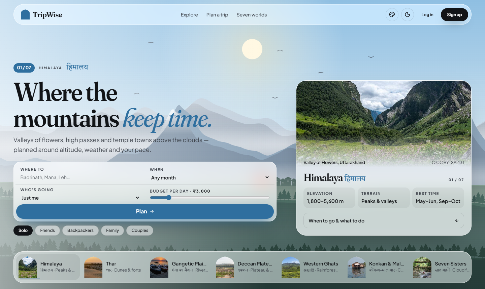

# ✈️ TripWise

**Plan less. Wander more.** TripWise is an AI-powered travel planner. Tell it where you're going, your dates, budget,
travel crew and vibe, and it builds a day-by-day itinerary with costs, local tips and a packing list.
You can then save it, download it as a PDF, or share it with your friends.



> 🚧 **Status: in active development.** The website and the real backend both work: accounts, passports and
> friends, saved trips, real AI itineraries (Gemini, with Groq as backup) grounded in a catalogue of 1,028 real
> places, TripWise's own free Quick plan, and Tolis for planning together (polls, suggestions, a group
> chat, fair money splitting and on-the-trip tools). Next: launch on Cloudflare Pages +
> Render. See the [roadmap](#-roadmap).

---

## ✨ Features

| | Feature | Status |
|---|---|---|
| 🔐 | Sign up / log in with email, secure sessions (short tokens + rotating cookie) | ✅ Done (Google sign-in later) |
| 🏠 | Homepage that leads into planning: the seven worlds, places at their best this month | ✅ Done |
| 📅 | Month-by-month guide: tap a month for its weather (IMD averages), festivals with dates, and what's in season | ✅ Done |
| 🏞️ | "Seven Worlds": a living, hand-drawn landscape of seven Indian regions behind every page | ✅ Done |
| 🌗 | Day and Night for every world, region colours, a Colours menu that tints the site from your photo (kept on your account), Calm motion | ✅ Done |
| 📱 | Mobile-first layout with an app-style bottom tab bar | ✅ Done |
| 🧭 | Explore 94 destinations (88 in India across all seven worlds, nature-heavy in the Himalaya and the North-East; 6 abroad) by world, vibe, budget and best month | ✅ Done |
| 📖 | A written guide on every Indian destination's page — about, history, why it matters, things to do, food to try — adapted from Wikivoyage and Wikipedia (CC BY-SA 4.0, credited) and checked against them | ✅ Done |
| 📍 | Places catalogue: 1,763 real places across 88 Indian destinations in all seven worlds (Wikidata, credited Commons photos) | ✅ Done |
| 🧠 | AI plans grounded in real places; TripWise's own planner as a free, unlimited Quick plan and when the AI is down | ✅ Done |
| 💬 | **Ask TripWise**: ask anything about a trip — answered from your plan, real places nearby (with chips) and the MET Norway forecast; follow-up questions; private per person, also on a Toli's trip (20 questions a day free) | ✅ Done |
| 🪄 | Trip planner wizard + real AI itineraries that appear day by day (5 free plans a day) | ✅ Done |
| 🎟️ | Day-by-day itinerary (timed stops, transfers, costs), regenerate a day, PDF, share link | ✅ Done |
| ⚡ | Similar trips served instantly from a plan cache (free, doesn't use the daily allowance) | ✅ Done |
| 🛂 | Passport: photo, bio and traveller type; India's seven worlds lighting up; 12 Yatra marks; visa-page stamps with trip journals (diya ratings, memories, photos) | ✅ Done |
| 👥 | Friends by @username or invite link, public passports with privacy (Friends / Everyone / Only me), blocking | ✅ Done |
| 🪔 | **Toli** (टोली): plan a trip together with your Sahyatris — invite on WhatsApp or by link, Sutradhar / Sah-Sutradhar / Sahyatri roles, friends / family / college / office trips, no member limit | ✅ Done |
| 🗳️ | Deciding together: Sujhav (suggest changes to the Sahyatra, vote, the Sutradhar approves), polls for dates (Tithi), destination (compared on TripWise's facts), transport or anything, private budget comfort | ✅ Done |
| 💬 | Chaupal, the Toli's chat: replies, @mentions, photos, live poll and suggestion cards, messages that wait for signal and send themselves; announcement mode where Sahyatris raise a hand (Anurodh); activity feed | ✅ Done |
| 💰 | **Lekha** (लेखा), the Toli's money: expenses split only among those who shared them (equally, by amounts or by shares, to the paisa), private personal expenses, who owes whom, the fewest payments to settle up with **Pay with UPI** or mark settled, totals against TripWise's estimate; works without signal | ✅ Done |
| 🔤 | Indian or English names: Toli, Sahyatri, Chaupal… or Group, Member, Group chat — each person chooses (saved on the account) | ✅ Done |
| 🧭 | On the trip: split a day into **Dharas** that meet again at a **Sangam** ("I'm here" headcount; fixed groups for college and office trips), **"Where are my Sahyatris?"** (opt-in, time-limited, Toli only, "near <place>" + Open in Maps), shared notes and the **Potli** packing list | ✅ Done |
| 💌 | **Kushal** (कुशल), family check-in for Toli and solo trips: private links for family (no account), latest check-in only (rounded to ~1 km), Send on WhatsApp, automatic check-ins while TripWise is open | ✅ Done |
| 📸 | Toli album, voice notes in Chaupal, and the trip offline on the phone | 📅 Next |
| 🔑 | Account: preferences that pre-fill the planner, change password, forgot password, sign out everywhere, delete my data | ✅ Done |
| 📊 | Admin dashboard: overview counts, find / block travellers and change plans, hide destinations from Explore, reports of public passports (dismiss, remove content, block), an audit log — never anyone's private trips | ✅ Done |
| 🧪 | End-to-end browser tests (Playwright) for a traveller's day and an admin | ✅ Done |
| 📲 | React Native mobile app | 📅 Phase 2 |

## 🎨 Design: "Seven Worlds"

India is not one place, so TripWise isn't one look. The whole site floats as frosted glass over a
**living landscape drawn live in your browser**: seven regions divided by landscape, not state lines.

| World | You'll see |
|---|---|
| Himalaya | snow peaks, pine ridges, drifting mist; stars and falling snow at night |
| Thar | dunes, a golden fort, a camel caravan, blowing sand; a sky full of stars |
| Gangetic Plains | the ghats' temple skyline, boats and kites over the river; floating diyas at night |
| Deccan Plateau | mesas, Hampi-style boulders and ruins; fireflies at night |
| Western Ghats | monsoon rain, rolling cloud, waterfalls on green ridges |
| Konkan & Malabar | sea, breaking waves, sun glitter, swaying palms |
| Seven Sisters | tea terraces disappearing into mist; fireflies at night |

- **Always moving:** the layers shift with your mouse and as you scroll, and the homepage tours the seven
  worlds until you pick one. TripWise remembers your pick.
- **Day and Night** for every world; the interface takes on each world's colours.
- **Region dossier:** elevation, terrain, a 12-month "when to go" chart, signature experiences and places.
- **For every traveller:** Solo, Friends, Backpackers, Family and Couples each change what the plan offers.
- **Your colours:** pick a photo from a trip you loved and its colours tint the whole world
  (read on your device, never uploaded), or use your location to see the world nearest you.
- **Real places, blended in:** a photo of each region (Wikimedia Commons, free licences, credited on the
  photo) melts into the dossier and into the "Seven worlds" cards, where it dissolves into the painted landscape.
- **Fonts:** Fraunces (headlines), Plus Jakarta Sans (interface), Tiro Devanagari Hindi (Hindi).
- **Calm mode** (Passport page) and the OS "reduce motion" setting hold the world still.

Design spec: `docs/superpowers/specs/2026-10-17-seven-worlds-design.md` · prototype: `docs/design/tripwise-living.html`.

## 🧰 Tech stack (100% free tiers)

| Layer | Technology |
|---|---|
| Frontend | React 19, TypeScript, Vite, Tailwind CSS 4, React Router, TanStack Query, React Hook Form + Zod, Canvas 2D (procedural landscapes), Lenis |
| Backend | Node.js, Express 5, TypeScript, MongoDB (Mongoose), Zod |
| AI | Google Gemini Flash → Flash-Lite, then Groq (`gpt-oss-120b`, Qwen) as automatic fallbacks; every answer is validated |
| Database | MongoDB Atlas (free M0 cluster) |
| Hosting | Cloudflare Pages (frontend), Render (backend) |
| Testing | Vitest, Testing Library, MSW (mock API), Supertest + in-memory MongoDB (backend) |

The app is designed around free-tier limits. AI results are cached, each user gets a daily generation allowance,
and a friendly "waking up the server" banner covers the free backend's cold starts.

## 📁 Project structure

```
tripwise/
├── frontend/     React + TypeScript web app (see frontend/README.md)
├── backend/      Node.js + Express API with AI planning (see backend/README.md)
└── docs/
    ├── SRS.md                  Software requirements
    └── superpowers/
        ├── specs/              Design specifications
        └── plans/              Step-by-step implementation plans
```

## 🚀 Getting started

**Requirements:** Node.js 22 or newer.

```bash
git clone https://github.com/devKiNGCRiC/tripwise.git
cd tripwise/frontend
npm install
cp .env.example .env.local    # mock API is on by default; no backend or API keys needed
npm run dev                   # → http://localhost:5173
```

Demo accounts (mock mode):

| Email | Password | Role |
|---|---|---|
| `demo@tripwise.app` | `password123` | Traveller |
| `admin@tripwise.app` | `admin12345` | Admin |

**With the real backend**, everything starts from the project root with one command (needs your own free
MongoDB Atlas, Gemini and/or Groq keys; see [`backend/README.md`](backend/README.md)):

```bash
npm run setup                          # installs the root, backend and frontend packages
cp backend/.env.example backend/.env   # fill in the keys
npm --prefix backend run seed          # loads the Explore destinations and their places (once)
npm run dev                            # API on :4000 + website on :5173, talking to each other
```

| Root command | What it does |
|---|---|
| `npm run dev` | Website + real API together (logs labelled `api` / `web`) |
| `npm run dev:mock` | Website only, on the in-browser demo API (no keys needed) |
| `npm test` | Backend and frontend tests |
| `npm --prefix frontend run e2e` | End-to-end tests in a real browser (uses Edge on Windows; `PW_CHANNEL=chrome` for Chrome) |

Useful scripts (run inside `frontend/`):

```bash
npm test            # unit + integration tests
npm run typecheck   # TypeScript check
npm run lint        # ESLint
npm run build       # production build → dist/
```

### Still to set up (free accounts, before launch)

| Service | Used for | Until it's set up |
|---|---|---|
| **Cloudinary** (free plan) | Storing trip journal photos | Photos are kept in MongoDB (fine for testing; Atlas free has 512 MB) |
| **Brevo** (free, 300 emails/day) | Sending "forgot password" emails | The reset link is printed in the API log |

Add their keys to `backend/.env` (names in `backend/.env.example`); TripWise switches over by itself.

## 🗺️ Roadmap

- [x] **Frontend foundation:** theme, UI kit, auth pages, routing and guards, mock API, landing page
- [x] **Traveller features:** explore, trip planner, AI itinerary view, PDF, sharing, passport stamps
- [x] **Admin:** dashboard and management tools, plus end-to-end tests
- [x] **Backend:** Express API, MongoDB models, JWT auth, Gemini + Groq integration, streaming, caching and quotas
- [x] **Own planner:** places catalogue (Wikidata) + grounded AI plans, free unlimited Quick plans
- [x] **"Ask TripWise":** questions on each trip, grounded in the plan, nearby catalogue places and the forecast
- [x] **Profile, Passport & Friends:** account, journals, Yatra marks, friends and public passports
- [x] **Toli, part 1:** plan trips together: invites, roles, suggestions, polls, budget comfort, Chaupal chat
- [x] **Toli, part 2 (Lekha):** fair expense splitting, settle up with UPI, totals; Indian or English names
- [x] **Toli, part 3a:** Dharas and Sangam, where are my Sahyatris, Kushal family check-ins, notes, Potli
- [ ] **Toli, part 3b:** Toli album, voice notes, offline trip
- [ ] **Launch:** deploy to Cloudflare Pages + Render, installable PWA with offline trips
- [ ] **Premium:** paid plan with Razorpay
- [ ] **Phase 2:** React Native app, social sharing, AI chat assistant

## ☁️ Deployment

The frontend deploys to **Cloudflare Pages** from the `main` branch (free plan, commercial use allowed).
Step-by-step settings are in [`frontend/README.md`](frontend/README.md#deploy-free--cloudflare-pages).

## 🤝 Contributing

This is a personal project, but ideas and bug reports are welcome. Please open an issue.
Work happens on feature branches that are merged into `main` once tests pass.

## 👤 Author

**devKiNGCRiC**: [github.com/devKiNGCRiC](https://github.com/devKiNGCRiC)
